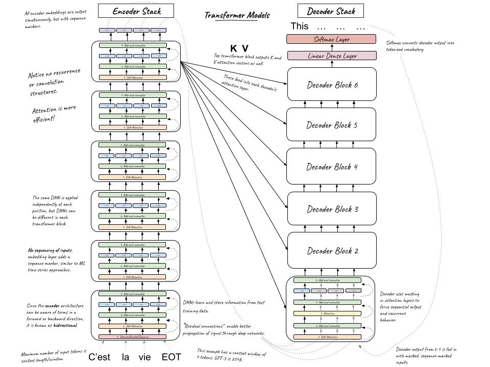
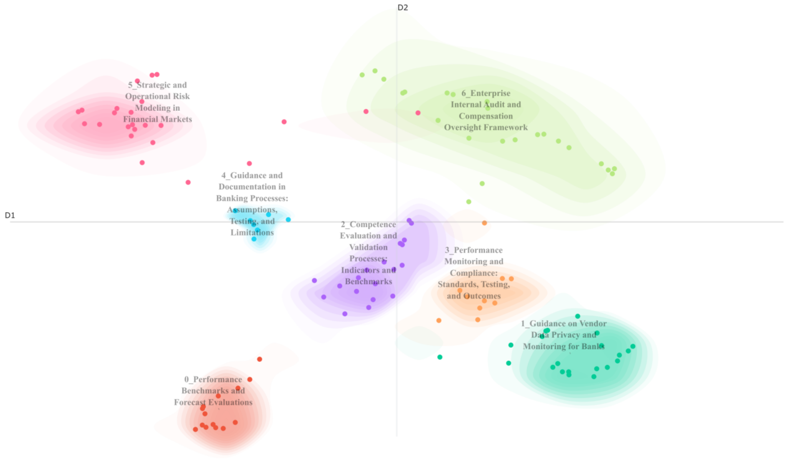

# DNSC 6290: LLMs: Concepts and Applications

Materials for a technical, nuts-and-bolts course on large language models,
their applications, and their evaluation.

## DNSC 6290: Course outline

1. [LLM and transformer foundations](#lecture-1-llm-and-transformer-foundations)
2. [Prompting and prompt development](#lecture-2-prompting-and-prompt-development)
3. [Model APIs, structured outputs, and typed decisions](#lecture-3-model-apis-structured-outputs-and-typed-decisions)
4. [Context engineering, memory, and state](#lecture-4-context-engineering-memory-and-state)
5. [RAG and knowledge pipelines](#lecture-5-rag-and-knowledge-pipelines)
6. [Tool use and agentic workflows](#lecture-6-tool-use-and-agentic-workflows)
7. [TEVV for LLM applications](#lecture-7-tevv-for-llm-applications)

Corrections or suggestions? Please [open an issue](https://github.com/jphall663/GWU_LLM/issues).

---

## Preliminary materials

- [Whiteboard notation](https://docs.google.com/presentation/d/1Axf9dizaE3XvGRelBHfsnAlMUPFuMExQ2WNVwQBKMrw/edit?usp=sharing)
- [Software configuration](#software-configuration)

## Lecture 1: LLM and transformer foundations

Tokens, embeddings, attention, transformers, generation; reasoning models and inference-time reasoning.



<sub><sup>Transformer encoder and decoder stacks with attention and feed-forward blocks. **Source:** Adapted from [Vaswani et al. (2017), *Attention Is All You Need*](https://arxiv.org/abs/1706.03762).</sup></sub>

### Lecture 1 class materials

- [Lecture slides](lecture/lec_1/lecture_1.pdf)
- **Software example:** [Predicting the next word](https://github.com/jphall663/GWU_LLM/blob/main/lecture/lec_1/next_word_primer.ipynb)

## Lecture 2: Prompting and prompt development

Instructions, system prompts, examples/in-context learning, templates, task
decomposition, and iterative refinement.

*Materials forthcoming.*

## Lecture 3: Model APIs, structured outputs, and typed decisions

Requests/responses, parameters, streaming, error handling; JSON schemas,
Pydantic validation, and Jev-style typed decisions.

*Materials forthcoming.*

## Lecture 4: Context engineering, memory, and state

Context assembly, windows and budgets, conversation history, persistent
memory, and state management.

*Materials forthcoming.*

## Lecture 5: RAG and knowledge pipelines

Ingestion, chunking, retrieval embeddings, vector/hybrid search, reranking,
grounded answers, and citations.

*Materials forthcoming.*

## Lecture 6: Tool use and agentic workflows

Function calling, external connectivity, MCP, bounded agent loops, and
orchestration; Text2SQL as a worked example.

*Materials forthcoming.*

## Lecture 7: TEVV for LLM applications

Measurement science, benchmarks and their limitations, LLM judges, embedding-
and classifier-based tests, red teaming, field testing, human review, and
validation of AI measurement instruments.



<sub><sup>Benchmark and embedding-based model testing should support a stated construct and decision rather than a leaderboard alone. **Source:** Sudjianto et al. (2024), [*Human-Calibrated Automated Testing and Validation of Generative Language Models*](https://arxiv.org/pdf/2411.16391).</sup></sub>

### Lecture 7 class materials

- [Lecture slides](lecture/lec_7/lecture_7.pdf)
- **Software examples:**
  - [Simple benchmark and embedding tests](https://github.com/jphall663/GWU_LLM/blob/main/lecture/lec_7/benchmark_embeddings.ipynb)
  - [LLM-as-a-judge validation](https://github.com/jphall663/GWU_LLM/blob/main/lecture/lec_7/llm_as_judge.ipynb)
  - [Bounded red-teaming examples](https://github.com/jphall663/GWU_LLM/blob/main/lecture/lec_7/red_teaming.ipynb)

## Software configuration

The examples use Python 3.13 and the locked project environment. From the
repository root, install [uv](https://docs.astral.sh/uv/getting-started/installation/)
and run:

```bash
uv sync --locked
```

The [project README](README.md) covers environment setup. Lecture 1's setup
notes include optional NVIDIA GPU acceleration.

---

This project is maintained by [jphall663](https://github.com/jphall663).
