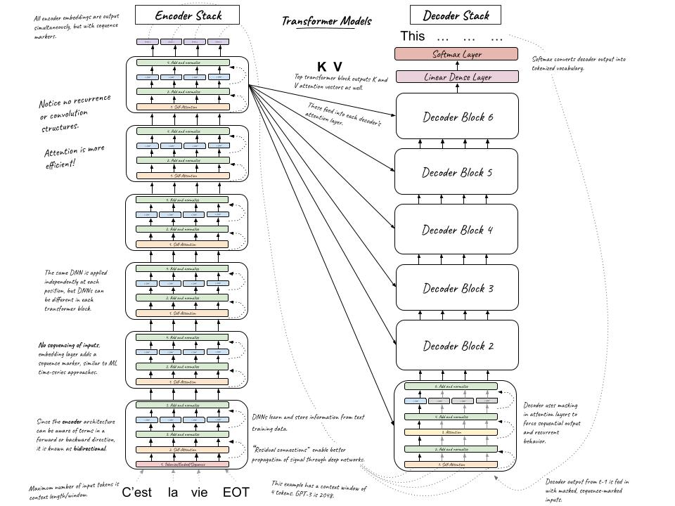
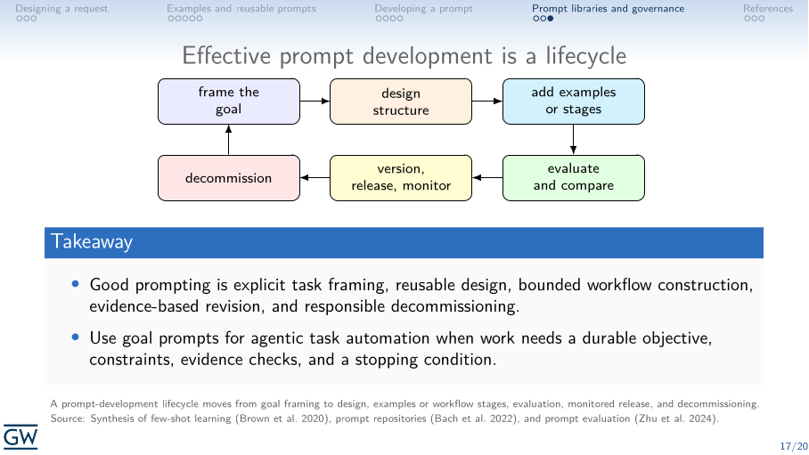
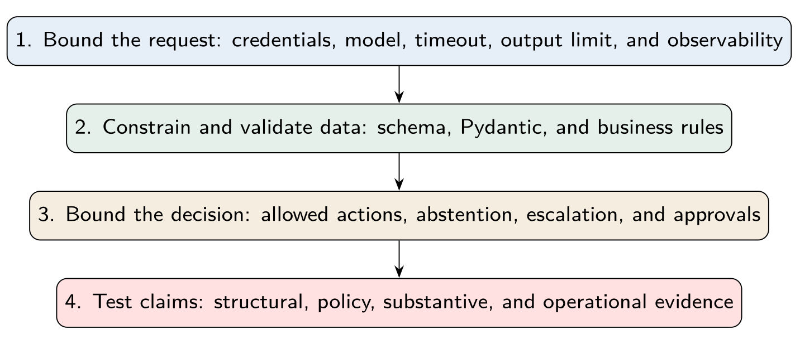
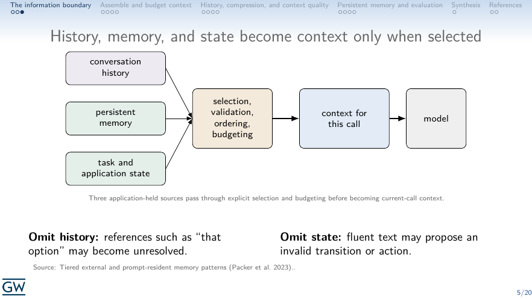
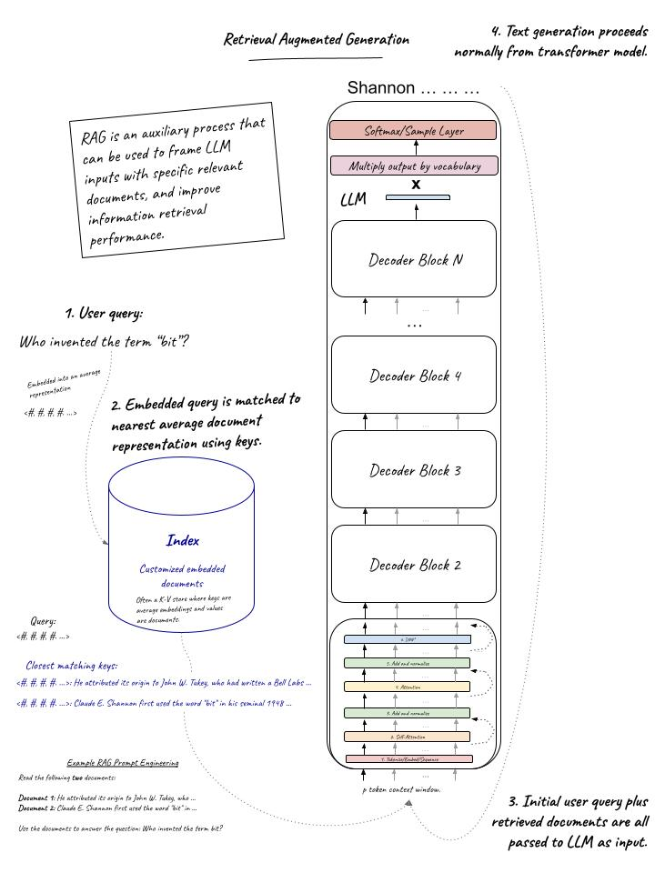
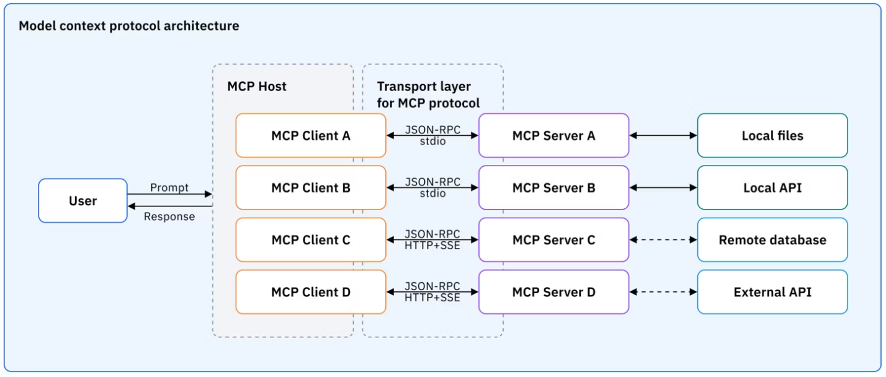
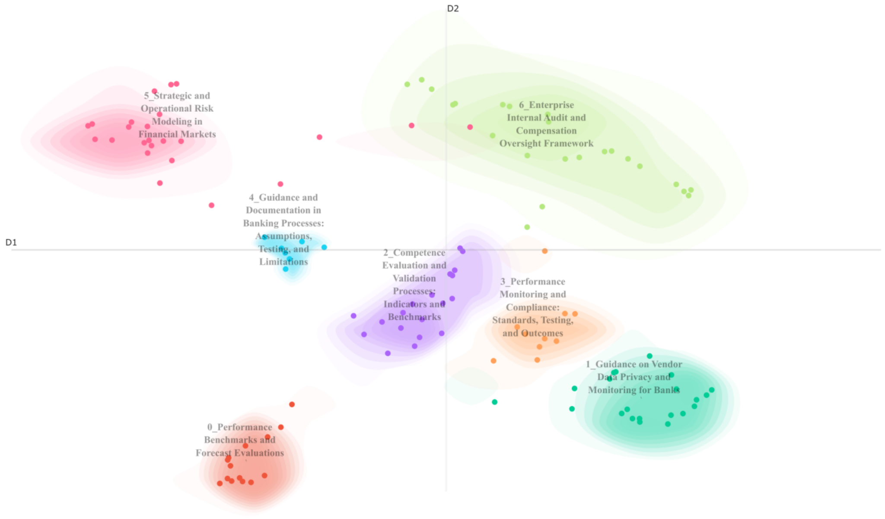

# DNSC 6290: LLMs: Concepts and Applications

Materials for a technical, nuts-and-bolts course on large language models,
their applications, and their evaluation.

## DNSC 6290: Course outline

1. [LLM and transformer foundations](#lecture-1-llm-and-transformer-foundations)
2. [Prompting and prompt development](#lecture-2-prompting-and-prompt-development)
3. [Model APIs, structured outputs, and typed decisions](#lecture-3-model-apis-structured-outputs-and-typed-decisions)
4. [Context engineering, memory, and state](#lecture-4-context-engineering-memory-and-state)
5. [RAG and knowledge pipelines](#lecture-5-rag-and-knowledge-pipelines)
6. [Tool use and agentic workflows](#lecture-6-tool-use-and-agentic-workflows)
7. [TEVV for LLM applications](#lecture-7-tevv-for-llm-applications)

Corrections or suggestions? Please [open an issue](https://github.com/jphall663/GWU_LLM/issues).

---

## Preliminary materials

- [Whiteboard notation](https://docs.google.com/presentation/d/1Axf9dizaE3XvGRelBHfsnAlMUPFuMExQ2WNVwQBKMrw/edit?usp=sharing)
- [Software configuration](#software-configuration)

## Lecture 1: LLM and transformer foundations

Tokens, embeddings, attention, transformers, generation; reasoning models and inference-time reasoning.

An encoder–decoder transformer stacks attention and feed-forward layers to produce token representations. Source: Lecture 1, Slide 11.

### Lecture 1 class materials

- [Lecture slides](lecture/lec_1/lecture_1.pdf)
- **Software example:** [Predicting the next word](https://github.com/jphall663/GWU_LLM/blob/main/lecture/lec_1/next_word_primer.ipynb)

## Lecture 2: Prompting and prompt development

Instructions, system prompts, examples/in-context learning, templates, task
decomposition, and iterative refinement.

A prompt-development lifecycle moves from goal framing and design through examples, evaluation, release, monitoring, and decommissioning. Source: Lecture 2, Slide 17.

### Lecture 2 class materials

- [Lecture slides](lecture/lec_2/lecture_2.pdf)
- **Software example:** [Practical prompt development](https://github.com/jphall663/GWU_LLM/blob/main/lecture/lec_2/prompt_development.ipynb)
- [Example goal prompt](https://github.com/jphall663/GWU_LLM/blob/main/lecture/lec_2/goal_prompt.md)

## Lecture 3: Model APIs, structured outputs, and typed decisions

Requests/responses, parameters, streaming, error handling; JSON schemas,
Pydantic validation, and Jev-style typed decisions.

Four API controls bound requests, validate data, constrain decisions, and test claims. Source: Lecture 3, Slide 18.

### Lecture 3 class materials

- [Lecture slides](lecture/lec_3/lecture_3.pdf)
- **Software example:** [Model APIs, structured outputs, and typed decisions](https://github.com/jphall663/GWU_LLM/blob/main/lecture/lec_3/model_apis_structured_outputs.ipynb)

## Lecture 4: Context engineering, memory, and state

Context assembly, windows and budgets, conversation history, persistent
memory, and state management.

Conversation history, persistent memory, and application state are selected and budgeted into context for a model call. Source: Lecture 4, Slide 6.

### Lecture 4 class materials

- [Lecture slides](lecture/lec_4/lecture_4.pdf)
- **Software example:** [Context engineering, memory, and state](https://github.com/jphall663/GWU_LLM/blob/main/lecture/lec_4/context_engineering.ipynb)

## Lecture 5: RAG and knowledge pipelines

Ingestion, chunking, retrieval embeddings, vector/hybrid search, reranking,
grounded answers, and citations.

A query retrieves relevant documents that augment the model prompt and support a cited answer. Source: Lecture 5, Slide 14.

### Lecture 5 class materials

- [Lecture slides](lecture/lec_5/lecture_5.pdf)
- **Software example:** [Cited RAG over NIST AI RMF actions](https://github.com/jphall663/GWU_LLM/blob/main/lecture/lec_5/rag_pipeline.ipynb)

## Lecture 6: Tool use and agentic workflows

Function calling, external connectivity, MCP, bounded agent loops,
orchestration, and agent identity; Text2SQL as a worked example.

An MCP host connects clients to tool servers over local or remote transports. Source: Lecture 6, Slide 9, adapted from IBM (n.d.), <a href="https://www.ibm.com/think/topics/model-context-protocol"><em>What is Model Context Protocol?</em></a>; transport labels follow the MCP (2025) <a href="https://modelcontextprotocol.io/specification/2025-11-25/basic/transports"><em>Transports</em> specification</a>.

### Lecture 6 class materials

- [Lecture slides](lecture/lec_6/lecture_6.pdf)
- **Software examples:**
  - [Text2SQL: fixed workflows and bounded agents](https://github.com/jphall663/GWU_LLM/blob/main/lecture/lec_6/text_to_sql.ipynb)
  - [Local MCP calculator](https://github.com/jphall663/GWU_LLM/blob/main/lecture/lec_6/mcp_calculator.ipynb)
- [Setup and server startup](lecture/lec_6/README.md)

## Lecture 7: TEVV for LLM applications

Measurement science, benchmarks and their limitations, LLM judges, embedding-
and classifier-based tests, red teaming, field testing, human review, and
validation of AI measurement instruments.

Benchmark cases and embedding diagnostics provide complementary evidence for model testing. Source: Lecture 7, Slide 7, Sudjianto et al. (2024), <a href="https://arxiv.org/pdf/2411.16391"><em>Human-Calibrated Automated Testing and Validation of Generative Language Models</em></a>.

### Lecture 7 class materials

- [Lecture slides](lecture/lec_7/lecture_7.pdf)
- **Software examples:**
  - [Simple benchmark and embedding tests](https://github.com/jphall663/GWU_LLM/blob/main/lecture/lec_7/benchmark_embeddings.ipynb)
  - [LLM-as-a-judge validation](https://github.com/jphall663/GWU_LLM/blob/main/lecture/lec_7/llm_as_judge.ipynb)
  - [Bounded red-teaming examples](https://github.com/jphall663/GWU_LLM/blob/main/lecture/lec_7/red_teaming.ipynb)

## Software configuration

The notebooks use Python 3.13 and the repository's locked `uv` environment.
From the repository root, run `uv sync --locked` to create or update `.venv`,
then select that project environment as the notebook kernel. Notebooks that use
the OpenAI API load `OPENAI_API_KEY` from the ignored, repository-root `.env`
file or prompt for it securely.

The [project README](README.md) covers installing `uv` and Python, selecting
the kernel in VS Code, and lecture-specific setup instructions.

---

This project is maintained by [jphall663](https://github.com/jphall663).
